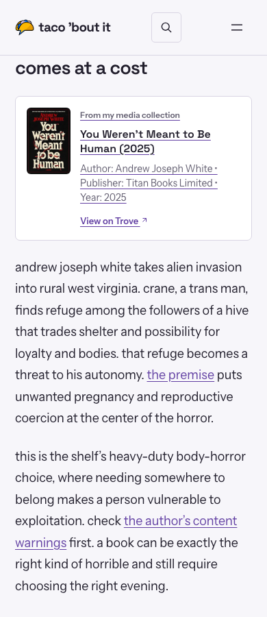
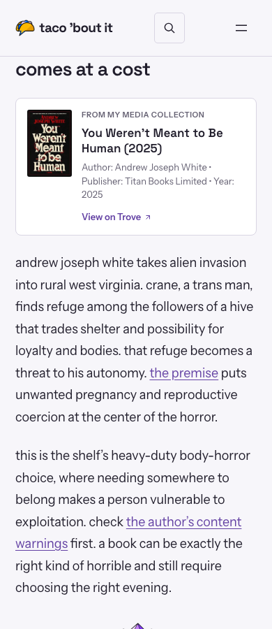

# Trove cards in articles

The supplied screenshot shows a plain inline link: card spans run together after the cover. These are server-rendered blog shortcode cards, not Trove iframes. Fresh public loads now receive the existing flex/grid stylesheet, so a historical cache failure cannot be proven. The current article-link rule does reproducibly underline the entire card, including label/title/metadata.

`trove.css` is a 2.3KB structural layer included with the HTML response, following sidebar/welcome styles. It preserves the card when external theme CSS is missing/stale. It also loads in the editor. The article-specific selector removes inherited underlines; only the CTA underlines on hover. Portrait and square artwork retain natural dimensions; missing artwork leaves a readable text card. No script, iframe resizing, polling, new production dependency, font or remote asset is added.

Reviewed public URL: https://tacobout.online/2026/10/18/halloween-shelf-books/

Public Chromium and WebKit captures covered 320, 375, 390 and 768px. Direct live captures were followed by a retained-HTML/CSS replay for aligned screenshots, excluding unrelated page scripts and iframe widgets. The proposed CSS was injected in the isolated review browser; nothing was changed on WordPress. `after-webkit-mobile.png` is the direct public WebKit rendering with proposed CSS and Google sign-in script blocked. The other retained screenshots replay actual public HTML/current CSS; no content or artwork was invented. WebKit is engine coverage, not a physical iPhone Safari claim.

Dedicated CI checks both engines at all four widths in light/dark, with portrait/square/missing artwork and long text. The structural layer is tested without the external theme stylesheet. Native link focus and Enter navigation remain functional. All 16 viewport/theme cases pass, with no overflow or relevant runtime error. Existing live analytics/ad messages are outside card behavior.

Local checks: 91 PHP tests / 410 assertions; 9 JavaScript tests; PHP syntax and whitespace clean; locked dependency audit reports no advisories. See the PR for exact-head completed CI.

| Before (390px) | Proposed (390px) |
| --- | --- |
|  |  |

[320px](screenshots/trove-cards/after-320.png) · [768px](screenshots/trove-cards/after-768.png) · [WebKit](screenshots/trove-cards/after-webkit-mobile.png)
